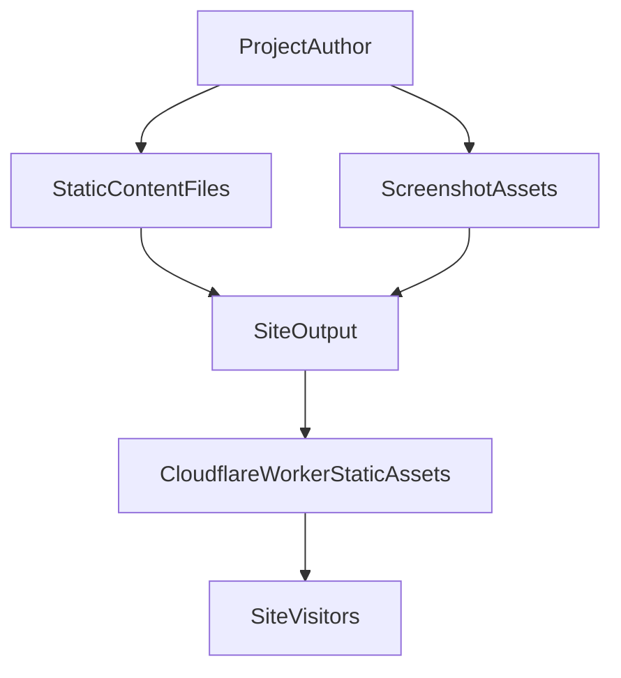

# Architecture

## Overview

This project uses a static-first architecture deployed with Cloudflare Workers Static Assets.

The site is mostly static files (HTML, CSS, images). Worker logic is optional and should only be introduced for concrete needs.

## Principles

- Keep runtime complexity low
- Prefer static content over dynamic rendering
- Use minimal dependencies
- Keep files readable and beginner-friendly

## High-Level Flow



## Proposed File Layout

```text
/
  README.md
  AGENTS.md
  CLAUDE.md
  .cursor/rules/
  docs/
  public/
    screenshots/
      <project-slug>/
        image-01.png
  src/ (optional if/when scripting is added)
```

## Routing Approach

- Static routes for project list and project detail pages
- Custom `404.html` page for not-found routes
- Avoid SPA routing complexity unless required later

## Serverless Usage Policy

Use Worker code only when there is a clear reason, for example:
- simple redirects
- tiny metadata/API endpoint
- future contact form handling

If no serverless behavior is needed, keep serving static assets only.

## Performance and Simplicity

- Keep image sizes reasonable
- Prefer compressed screenshot formats where practical
- Avoid heavy client-side scripts
- Preserve fast load times by default
